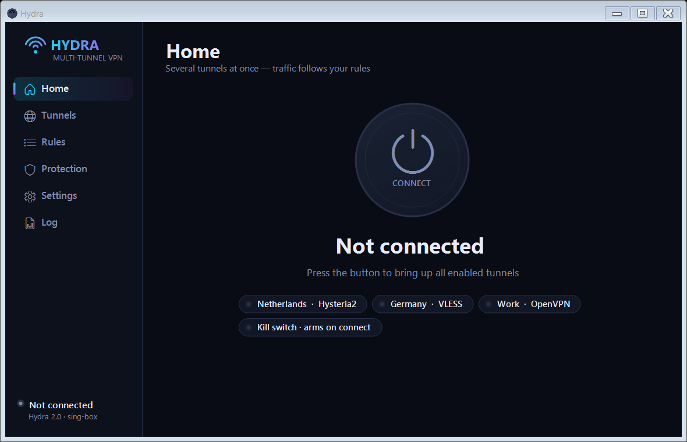
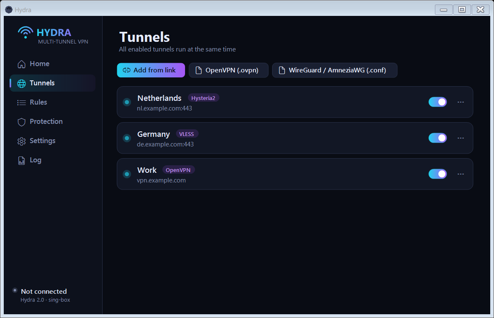
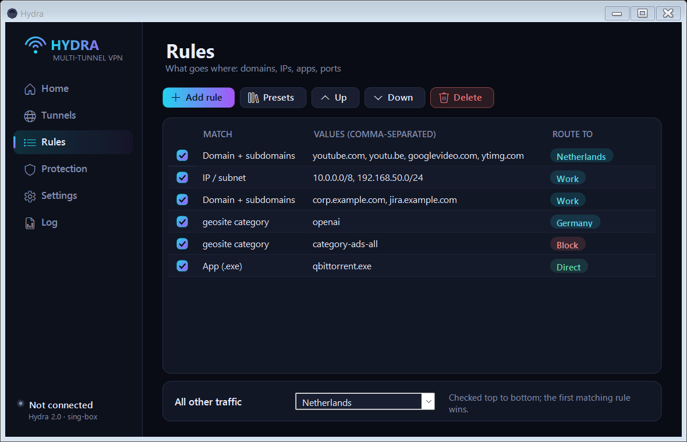
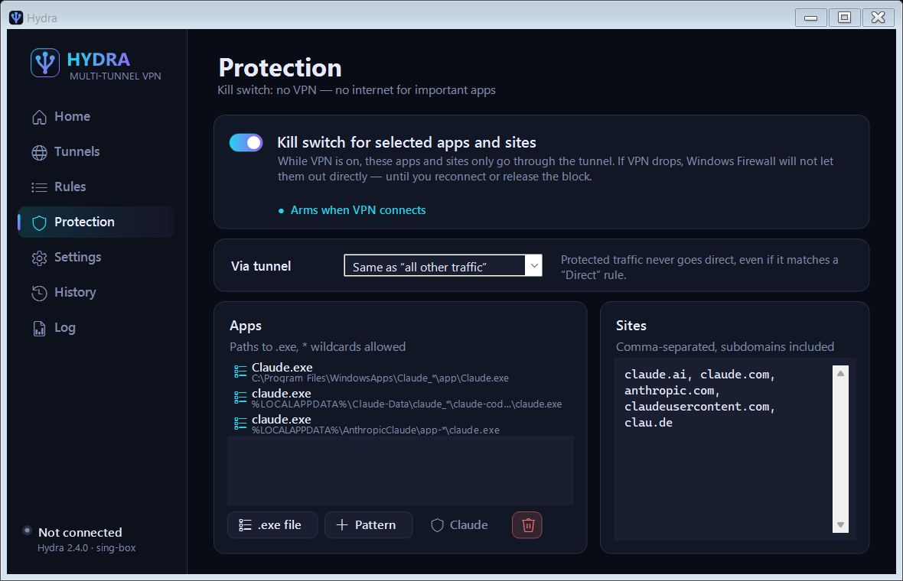

# Hydra

**One Windows VPN client, many tunnels at once.** Hydra keeps Hysteria2, VLESS, OpenVPN, WireGuard, AmneziaWG and more connected *simultaneously* and routes every connection by your rules — YouTube through one server, work subnets through the corporate OpenVPN, local sites direct.

[Русская версия](README.ru.md)



## Features

- **Hysteria2 Wi-Fi relay.** Open the Hysteria2 tunnel menu and choose **Wi-Fi relay…** to enter a Windows network name and relay host. The relay forwards UDP to the VPN server on the port from the link. With auto-reconnect enabled, five timeouts within one minute trigger HTTPS checks through both paths. Hydra also checks the active path every 45 seconds to catch stalled connections. If only the alternate responds, Hydra switches that tunnel. If both fail, it checks again after 30 seconds. Path changes appear in History.
- **Multiple tunnels at the same time.** All enabled tunnels come up together; there is no "pick one server".
- **Rule-based routing.** Route by domain (with subdomains), exact domain, keyword, geosite category, IP/subnet, geoip country, app (`.exe`) or port. First match wins; everything else goes to a tunnel or direct.
- **Kill switch per app and per site.** Selected apps (Claude Desktop and Claude Code by default) and sites never leave the tunnel. If the VPN drops, Windows Firewall blocks them from going out directly.
- **OpenVPN without installing OpenVPN.** `.ovpn` files are converted to the OpenVPN client built into sing-box 1.14. Routes and DNS pushed by the server are picked up automatically.
- **Import anything.** `vless://`, `vmess://`, `trojan://`, `ss://`, `hy2://`, `hysteria://`, `tuic://`, base64 subscriptions, `.ovpn`, WireGuard / AmneziaWG `.conf`.
- **Split DNS.** Domains routed into a tunnel are resolved through that tunnel; direct domains use the system resolver.
- **Presets.** One-click rules for YouTube, Telegram, Discord, Meta, X, AI services, Russian sites, ads.
- **Dark, modern UI.** English and Russian.
- **Live speed per tunnel.** The Home page shows ↓/↑ for every tunnel and for direct traffic, with a one-minute graph.
- **History, logs and crash reports.** Connects, disconnects, VPN drops, tunnel failures and crashes, with logs kept on disk for 14 days.
- **Notifications and tray.** Windows notifications when something fails. Closing the window keeps Hydra running in the tray, and the tray menu shows status and speed.
- **Self-updating.** Hydra checks GitHub for new releases and updates itself in one click, verifying the file by SHA-256.
- **Tiny and dependency-free.** A ~170 KB executable built with the compiler that ships with Windows. No .NET SDK, no installers.

| Tunnels | Rules | Kill switch |
|---|---|---|
|  |  |  |

## Supported protocols

| Protocol | Engine |
|---|---|
| VLESS (TLS / REALITY, tcp / ws / grpc / httpupgrade / h2), VMess, Trojan, Shadowsocks (incl. 2022), Hysteria, Hysteria2, TUIC, WireGuard | sing-box |
| OpenVPN | sing-box 1.14+ built-in client (default), or external `openvpn.exe` (dco / wintun / tap drivers) |
| AmneziaWG | `amneziawg-go.exe` as a separate process |

## How it works

```
 apps ─► TUN "Hydra" (sing-box) ─► rules ─┬─► Hysteria2 / VLESS / … outbounds
                                          ├─► OpenVPN client (inside sing-box)
                                          ├─► adapter MT-xxxx ─► amneziawg-go.exe
                                          └─► direct
```

sing-box captures all traffic through a TUN adapter and picks an outbound for every connection. External tunnels (AmneziaWG, or OpenVPN with an external driver) bring up their own adapters without touching system routes; sing-box sends traffic into them with `bind_interface`. Their own server connections bypass the TUN, so there are no loops.

### Kill switch

While Hydra is connected, protected apps and sites are pinned to a tunnel and never go direct. Hydra also adds Windows Firewall rules named `Hydra KillSwitch`. They block outbound traffic from those apps and to those sites unless it leaves through Hydra's TUN address. If sing-box dies, the traffic would fall back to Wi-Fi/Ethernet with a different local address, and the firewall drops it.

- **Disconnect** removes the rules.
- If the VPN **drops on its own**, the rules stay. You get a tray notification and a **Release block** button on the Home page.
- App paths support `*` wildcards, because Store apps keep the version in the path.

## Getting started

1. Download **`Hydra.exe`** from [Releases](https://github.com/iceliteyopta/hydra-vpn/releases/latest) and run it. It asks for administrator rights, which the TUN adapter and firewall rules need.
2. On first launch Hydra downloads the official sing-box core into `cores\` by itself. The archive is verified against the SHA-256 published by GitHub, and this happens only once.
3. **Tunnels**: add links or import `.ovpn` / `.conf`. **Rules**: add rules or presets and choose where *all other traffic* goes. Press the big power button.

Requirements: Windows 10/11 x64. .NET Framework 4.x is already part of Windows. The exe is not code-signed, so SmartScreen may ask you to confirm (*More info → Run anyway*).

Optional: for AmneziaWG, put `amneziawg-go.exe` and `wintun.dll` into `cores\amneziawg\`.

### Build from source

```powershell
powershell -ExecutionPolicy Bypass -File build.ps1      # uses csc.exe that ships with Windows
powershell -ExecutionPolicy Bypass -File get-singbox.ps1 # optional: fetch the core without starting Hydra
```

## Files

```
Hydra.exe
cores\sing-box.exe        ← get-singbox.ps1
data\profile.json         ← tunnels, rules, settings (OpenVPN passwords encrypted with DPAPI)
data\tunnels\<id>\        ← imported .ovpn / .conf files
```

`data\` holds your keys and passwords. Never commit or share it.

## Command line

| Command | What it does |
|---|---|
| `Hydra.exe --selftest <dir>` | Parses sample links, builds a config, writes `config.json` and `selftest.txt` |
| `Hydra.exe --gen-config <file>` | Writes the sing-box config for the current profile |
| `Hydra.exe --screenshots <dir> [en\|ru]` | Renders UI pages to PNG |
| `Hydra.exe --add-link <link> [name]` | Adds a tunnel from a link |
| `Hydra.exe --add-ovpn <file> [name]` | Imports an OpenVPN config |
| `Hydra.exe --add-rule <kind> <values> <target>` | Adds a routing rule |
| `Hydra.exe --set-final <target>` | Sets where all other traffic goes |
| `Hydra.exe --set-killswitch on\|off` | Toggles the kill switch |

## Limitations

- The xhttp transport and Shadowsocks plugins are not supported by sing-box.
- AmneziaWG is IPv4-only.
- Amnezia `vpn://` share links are not imported. Export a `.conf` instead.
- Windows only (WinForms).

## License

[MIT](LICENSE). sing-box is a separate project licensed under GPL-3.0 and is downloaded, not bundled.
