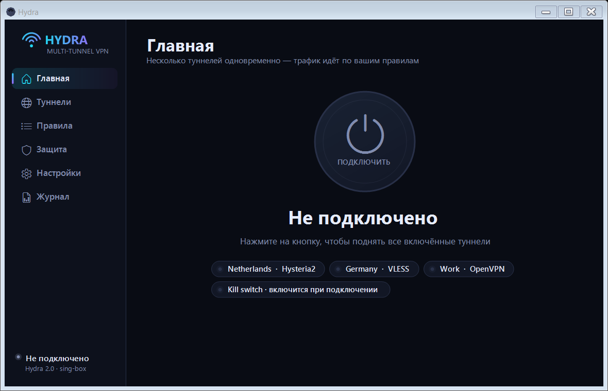
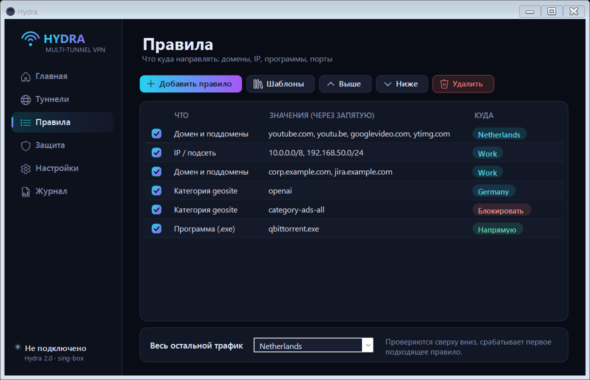

# Hydra

**Один VPN-клиент для Windows — много туннелей одновременно.** Hydra держит Hysteria2, VLESS, OpenVPN, WireGuard, AmneziaWG и другие протоколы подключёнными *одновременно* и раскидывает каждое соединение по вашим правилам: YouTube через один сервер, рабочие сети через корпоративный OpenVPN, российские сайты напрямую.

[English version](README.md)



## Возможности

- **Несколько туннелей сразу.** Все включённые туннели поднимаются вместе, выбирать один сервер не нужно.
- **Маршрутизация по правилам.** Правила по домену (с поддоменами), точному домену, слову в домене, категории geosite, IP/подсети, стране geoip, программе (`.exe`) или порту. Срабатывает первое подходящее. Весь остальной трафик идёт в выбранный туннель или напрямую.
- **Kill switch для отдельных программ и сайтов.** Выбранные программы (по умолчанию Claude Desktop и Claude Code) и сайты никогда не ходят мимо туннеля. Если VPN упал, брандмауэр Windows не выпускает их напрямую.
- **OpenVPN без установки OpenVPN.** `.ovpn` переводится во встроенный OpenVPN-клиент sing-box 1.14. Маршруты и DNS от сервера подхватываются автоматически.
- **Импорт чего угодно.** `vless://`, `vmess://`, `trojan://`, `ss://`, `hy2://`, `hysteria://`, `tuic://`, подписки в base64, `.ovpn`, `.conf` WireGuard / AmneziaWG.
- **Раздельный DNS.** Домены, которые идут в туннель, резолвятся через этот туннель. Домены, которые идут напрямую, резолвит системный DNS.
- **Шаблоны.** Правила в один клик: YouTube, Telegram, Discord, Meta, X, ИИ-сервисы, российские сайты, реклама.
- **Тёмный современный интерфейс.** Русский и английский языки.
- **Маленький и без зависимостей.** Собирается компилятором C#, встроенным в Windows. Не нужны .NET SDK и установщики.



## Протоколы

| Протокол | Чем обслуживается |
|---|---|
| VLESS (TLS / REALITY, tcp / ws / grpc / httpupgrade / h2), VMess, Trojan, Shadowsocks (вкл. 2022), Hysteria, Hysteria2, TUIC, WireGuard | sing-box |
| OpenVPN | встроенный клиент sing-box 1.14+ (по умолчанию) или внешний `openvpn.exe` (драйверы dco / wintun / tap) |
| AmneziaWG | `amneziawg-go.exe` отдельным процессом |

## Как это работает

```
 программы ─► TUN «Hydra» (sing-box) ─► правила ─┬─► Hysteria2 / VLESS / … 
                                                 ├─► OpenVPN-клиент (внутри sing-box)
                                                 ├─► адаптер MT-xxxx ─► amneziawg-go.exe
                                                 └─► напрямую
```

### Kill switch

Пока Hydra подключена, защищённые программы и сайты закреплены за туннелем и никогда не идут напрямую. Кроме того, Hydra добавляет правила брандмауэра Windows `Hydra KillSwitch`. Они блокируют исходящий трафик этих программ и к этим сайтам, если он выходит не через адрес TUN Hydra. Если sing-box упадёт, трафик пошёл бы через Wi-Fi/Ethernet с другим локальным адресом, и брандмауэр его отбросит.

- Кнопка **«Отключить»** снимает правила.
- Если VPN **упал сам**, правила остаются. Приходит уведомление в трее, а на главной появляется кнопка **«Снять блокировку»**.
- В путях к программам можно использовать `*`: у приложений из Microsoft Store в пути есть версия.

## Быстрый старт

1. Скачайте или клонируйте репозиторий.
2. Соберите (нужен `csc.exe` из .NET Framework 4.x, он уже есть в Windows 10/11):
   ```powershell
   powershell -ExecutionPolicy Bypass -File build.ps1
   ```
3. Скачайте ядро sing-box (официальный релиз ляжет в `cores\`):
   ```powershell
   powershell -ExecutionPolicy Bypass -File get-singbox.ps1
   ```
4. Запустите `Hydra.exe`. Программа попросит права администратора: они нужны для TUN и правил брандмауэра.
5. **Туннели**: добавьте ссылки или импортируйте `.ovpn` / `.conf`. **Правила**: добавьте правила или шаблоны и выберите, куда идёт *весь остальной трафик*. Нажмите большую кнопку питания.

Для AmneziaWG положите `amneziawg-go.exe` и `wintun.dll` в `cores\amneziawg\`.

## Файлы

```
Hydra.exe
cores\sing-box.exe        ← get-singbox.ps1
data\profile.json         ← туннели, правила, настройки (пароли OpenVPN зашифрованы DPAPI)
data\tunnels\<id>\        ← импортированные .ovpn / .conf
```

В `data\` лежат ваши ключи и пароли. Не публикуйте эту папку и никому её не передавайте.

## Командная строка

| Команда | Что делает |
|---|---|
| `Hydra.exe --selftest <папка>` | Разбирает тестовые ссылки, собирает конфиг, пишет `config.json` и `selftest.txt` |
| `Hydra.exe --gen-config <файл>` | Сохраняет конфиг sing-box для текущего профиля |
| `Hydra.exe --screenshots <папка> [en\|ru]` | Сохраняет снимки окна в PNG |
| `Hydra.exe --add-link <ссылка> [имя]` | Добавляет туннель по ссылке |
| `Hydra.exe --add-ovpn <файл> [имя]` | Импортирует конфиг OpenVPN |
| `Hydra.exe --add-rule <тип> <значения> <куда>` | Добавляет правило |
| `Hydra.exe --set-final <куда>` | Куда идёт весь остальной трафик |
| `Hydra.exe --set-killswitch on\|off` | Включает или выключает kill switch |

## Ограничения

- Транспорт xhttp и плагины Shadowsocks не поддерживаются ядром sing-box.
- AmneziaWG работает только по IPv4.
- Ссылки `vpn://` из приложения Amnezia не импортируются, экспортируйте `.conf`.
- Только Windows (WinForms).

## Лицензия

[MIT](LICENSE). sing-box — отдельный проект под GPL-3.0. Он скачивается отдельно и не входит в репозиторий.
